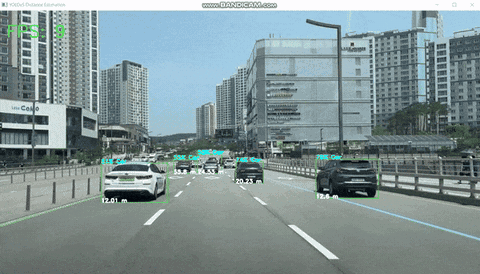

# Yolov5_Car_Distance

YOLOv5 기반 블랙박스 영상 차량 · 보행자 탐지 및 거리 추정

<br/>



<br/><br/>

## Object

<br/>

- 블랙박스 영상에서 차량·사람 탐지 후 내 차와의 거리 표시
- 거리 센서 없이 카메라 영상만으로 차간 거리 확인
- 사고 예방용 감지 센서 역할을 목표로 구현

<br/><br/>

## Content

<br/>

1. Module 소개

2. 진행 과정

3. 거리 계산 방법

4. Result

5. 실행 방법

6. Version

7. Feedback

<br/><br/>

## 1. Module 소개

<br/>

- `main.py` : 영상 기반 거리 추정 메인 모듈
  - `DistanceEstimationDetector` 클래스에서 전 과정 처리
  - 영상 읽기 → 탐지 → 박스·거리·FPS 표시
  - 탐지 대상 : person(0), car(2)
  - 신뢰도 0.40, IoU 0.45, GPU 자동 사용
- `test.py` : 이미지 한 장으로 탐지·거리 계산 사전 검증
- `input/` : 테스트 영상 3개(차량 2, 보행자 1)와 이미지
- `yolov5/` : YOLOv5 패키지 소스 (Ultralytics)

<br/><br/>

## 2. 진행 과정

<br/>

- `test.py` 로 이미지에서 차량 탐지·거리 계산 먼저 확인
- `main.py` 에서 영상 프레임마다 같은 계산을 하도록 클래스화
- 화면에 객체 이름, 거리(m), 신뢰도(%), FPS 표시
- 콘솔에도 동시 출력, `q` 입력 시 종료

<br/><br/>

## 3. 거리 계산 방법

<br/>

- 기준점 : 화면 하단 중앙 (내 차 위치로 가정)
- 대상점 : 객체 위치에 따라 박스 아래 모서리 또는 중앙
  - 화면 왼쪽 객체 → 박스 오른쪽 아래
  - 화면 오른쪽 객체 → 박스 왼쪽 아래
  - 화면 가운데 객체 → 박스 아래 중앙
- 거리 : 두 점 사이 픽셀 거리 ÷ 박스 높이 x 픽셀당 길이
- 카메라 보정 없는 화면 비율 기반 근사값

<br/><br/>

## 4. Result

<br/>

### ① 차량 주행 영상

<br/>


<br/>

- 앞차와 옆 차선 차량을 각각 탐지
- 가까운 차량일수록 거리가 작게 표시
- 처리 속도 약 10 FPS

<br/>

### ② 보행자 영상

<br/>


<br/>

- 사람이 많은 횡단보도에서도 사람별 거리 표시
- 사람이 겹치면 거리 숫자도 겹쳐 가독성 저하

<br/><br/>

## 5. 실행 방법

<br/>

```bash
pip install yolov5 opencv-python torch
python main.py    # main.py 하단 video_path 를 input/ 영상으로 변경 후 실행
```

<br/><br/>

## 6. Version

<br/>

- python 3.11
- torch
- yolov5 (pip 패키지)
- opencv-python
- numpy

<br/><br/>

## 7. Feedback

<br/>

- 일정 거리 이내 접근 시 경고 기준·신호 처리 추가 예정
- 초점거리·설치 높이로 보정하면 실제 거리에 근접 가능
- 영상 경로가 절대경로라 실행 인자 방식으로 변경 필요
